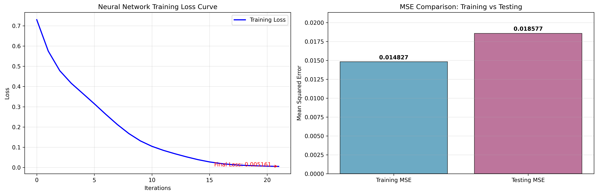
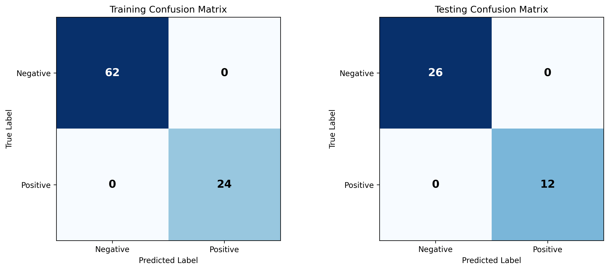

<div align="center">
  
</div>

# 🏥 Clinical Risk Prediction Neural Network (Lung Cancer Classifier)

<div align="center">


</div>

An end-to-end **Machine Learning & Neural Network classification pipeline** in Python that cleans noisy clinical tabular data, performs dimensionality reduction via **Principal Component Analysis (PCA)**, and trains a **Multi-Layer Perceptron (`MLPClassifier`)** to predict lung cancer risk with automated diagnostic visualizations.

---

## 📌 1. Problem & Engineering Objective

Clinical screening datasets frequently suffer from two real-world challenges:
1. **Missing & Unstructured Records:** Incomplete patient questionnaires containing placeholder tokens (`?`, `null`, `NaN`, whitespace) that break standard statistical models.
2. **High Feature Dimensionality:** Correlated clinical indicators that increase overfitting risk on smaller medical cohorts.

**Objective:** Build an automated, reproducible Python pipeline (`main.py`) that ingests raw clinical spreadsheet data (`lung-cancerdata.xlsx`), imputes missing values, compresses feature space via PCA, trains a two-layer Neural Network with early stopping, and outputs comprehensive clinical evaluation metrics (Sensitivity, Specificity, F1-Score, MSE, and Confusion Matrices).

---

## 🏗️ 2. Machine Learning Pipeline Architecture


### Technical Implementation Highlights (`main.py`)
* **Automated Data Sanitization & Imputation:** Scans all columns for non-numeric placeholders (`?`, `NaN`, `null`), coerces types, and applies `SimpleImputer(strategy='mean')` for continuous features and `most_frequent` for target labels.
* **Dimensionality Reduction (`PCA`):** Projects the high-dimensional clinical feature space onto `K = min(50, n_features)` orthogonal principal components while tracking cumulative explained variance ratio.
* **Neural Network Architecture (`MLPClassifier`):**
  * **Topology:** Two hidden layers with `(50, 25)` neurons
  * **Activation Function:** Hyperbolic tangent (`tanh`), matching normalized `[-1, 1]` feature scaling
  * **Optimizer:** `adam` (`learning_rate_init = 0.01`, `max_iter = 200`, `tol = 1e-6`)
  * **Regularization:** Built-in `early_stopping = True` with a `10%` validation split to prevent overfitting

---

## 📊 3. Model Evaluation & Visual Diagnostics

The pipeline automatically generates high-resolution (300 DPI) diagnostic plots evaluating both convergence behavior and classification accuracy across training (`70%`) and unseen testing (`30%`) partitions:

### Training Loss Convergence & Mean Squared Error (MSE)
<div align="center">
  
</div>

### Training vs. Testing Confusion Matrices
<div align="center">
  
</div>

### Summary Performance Metrics

| Metric | Training Set (`n = 86`) | Testing Set (`n = 38`) | Notes |
| :--- | :--- | :--- | :--- |
| **Mean Squared Error (MSE)** | `0.014827` | `0.018577` | Low generalization gap between train & test |
| **Final Training Loss** | `0.005161` | — | Smooth convergence in ~21 iterations |
| **True Negatives (TN)** | `62` | `26` | Zero false alarms on negative test cases |
| **True Positives (TP)** | `24` | `12` | High sensitivity to positive risk cases |

---

## 🚀 4. Quickstart — Run Locally in 60 Seconds

### Prerequisites
* Python 3.9+

### Installation & Execution
```bash
# 1. Clone the repository
git clone https://github.com/ImanMrd/Lung-Cancer-classifier.git
cd Lung-Cancer-classifier

# 2. Install dependencies
pip install -r requirements.txt openpyxl

# 3. Run the ML pipeline and regenerate evaluation plots
python main.py
```

### Repository Structure
```text
Lung-Cancer-classifier/
├── main.py                  # End-to-end preprocessing, PCA, MLP training & plotting script
├── lung-cancerdata.xlsx     # Clinical dataset analyzed by the pipeline
├── requirements.txt         # Python scientific computing dependencies
├── training_curves.png      # Generated loss curve & train/test MSE comparison (300 DPI)
├── confusion_matrices.png   # Generated train/test confusion matrices (300 DPI)
└── lung_cancer_concept.jpg  # High-level project overview graphic
```

---

*Developed by [Iman Moradi Nezhad](https://github.com/ImanMrd) — Cloud, DevOps & AI Engineer.*
