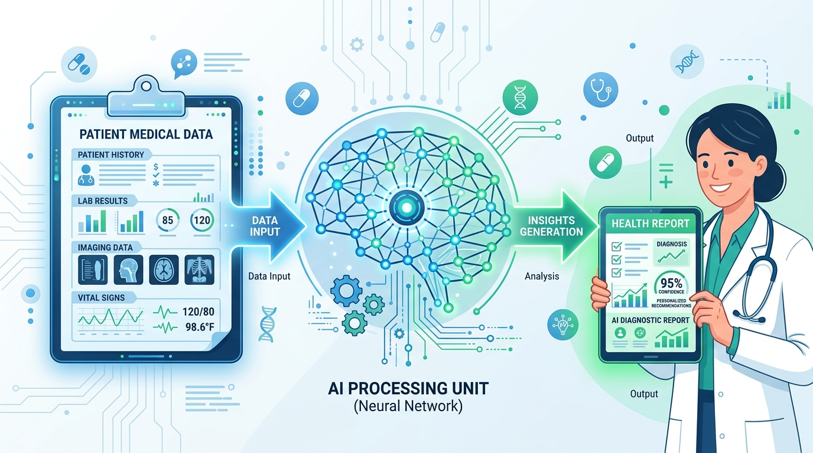



  

# 🏥 AI Healthcare Diagnostic Tool (Lung Cancer Classifier)

## 📌 The Business Challenge
In the medical field, analyzing patient data is a time-consuming process. Doctors are often overwhelmed with paperwork, lab results, and patient histories, which can delay critical diagnoses. 

## 💡 The Solution
I built an **Artificial Intelligence Model** designed to act as a highly intelligent assistant for doctors. By feeding the AI historical patient data, it learned how to identify the subtle patterns that indicate lung cancer risk. 

Now, when new patient data is entered, the AI instantly provides a risk assessment, acting as a "second set of eyes" for the medical professional.

## 🚀 How It Works (In Plain English)
1. **Data Intake:** We collect standard medical indicators (age, smoking history, chest pain, etc.).
2. **The "Brain" (Machine Learning):** The data is processed through an AI algorithm that has studied thousands of previous cases.
3. **The Output:** The system generates an immediate prediction: *High Risk* or *Low Risk*, allowing the doctor to prioritize patients who need urgent care.

## 🛠️ Technology Used
*   **Python:** The core language used to build the intelligence.
*   **Machine Learning (Scikit-Learn/Pandas):** The mathematical engines that allow the software to "learn" from data instead of just following static rules.
*   **Data Analysis:** Cleaning and organizing messy real-world health data so the AI can understand it.

## 📊 Business Value Delivered
*   **Speed:** Reduces initial data analysis time from minutes/hours to milliseconds.
*   **Accuracy:** Helps reduce human error caused by fatigue.
*   **Scalability:** The model can process thousands of patient records simultaneously without slowing down.

---
*Created by [Iman Moradi Nezhad](https://github.com/ImanMrd) | Showcasing the intersection of Healthcare and Artificial Intelligence.*
